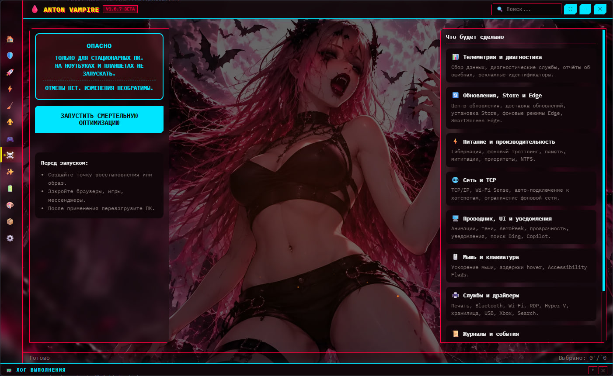

<h1 align="center">
  <br/>
  Anton Vampire
</h1>

  <p align="center">
  <b>Windows-оптимизатор на Electron</b><br/>
  <sub>1000+ твиков · 80+ тем · Material You · Cyberpunk 2077 · Portable</sub>
</p>

<p align="center">
  <a href="https://github.com/ZikaSVG/Anton-Vampire/releases/latest">
    
  </a>
  <a href="https://github.com/ZikaSVG/Anton-Vampire/releases">
    
  </a>
  <a href="LICENSE">
    
  </a>
  <!-- 
   -->
</p>

<p align="center">
  <a href="https://github.com/ZikaSVG/Anton-Vampire/releases/download/v1.0.9-beta/Anton.Vampire.Setup.1.0.9-beta.exe">
    
  </a>
  <a href="https://github.com/ZikaSVG/Anton-Vampire/releases/download/v1.0.9-beta/Anton.Vampire.Portable.rar">
    
  </a>
</p>

---

## 🩸 Что это

**Anton Vampire** — полностью переписанный Windows-оптимизатор.
Наследник [All Tweaker](https://github.com/scode18/All-Tweaker) (Python / tkinter),
переехавший на **Electron 44 + Material You + Cyberpunk Style**.

<p align="center">
  <a href="web/screenshot.jpg">
    
  </a>
</p>

Внутри — **1000+ твиков**, сгруппированных по 13 вкладкам, **100+ тем**
(включая игровые, Catppuccin, Dark Reader, Cyberpunk),
аудит безопасности, управление автозагрузкой, службами, курсорами, обои
и портативный режим.

> ⚠️ Требуются **права администратора**. Приложение проверяет `fltmc` при старте
> и предлагает перезапуск через UAC.

---

## ✨ Новое в 1.0.7

- 💀 **Смертельная оптимизация** — отдельная вкладка с необратимым BAT-твиком
  (9 категорий, ~100 групп изменений в реестре и службах). Только для
  стационарных ПК, только с резервной копией.

- 🎮 **Игровой режим 2** — 14 готовых планов электропитания
  (Amit, Atlas, Bitsum, Quaked, XOS, Zoyata и др.) с импортом/активацией,
  Power Killer, массовое отключение 200+ служб
  с бэкапом `.reg` и безопасным fallback.

- 🔋 **Электропитание** — Power Killer, таблица результатов тестирования планов, ~80 источников питания
  (XOS, ImmortalOS, SystemX, Igromanoff, VainOS, SynergyOS, Другое).

- ⚙️ **Службы** — полноценный менеджер служб с таблицей, поиском, статусами,
  массовым включением/отключением и безопасным бэкапом.

- 🎨 **8 CSS-стилей:** Material 3, Pixel, Material You, Pretty Kitty,
  Cyberpunk 2077, Mini Punk, Alt Punk, Material Mini.

- 🌈 **~100+ тем** в 12 группах: Material 3, светлые, тёмные ttkbootstrap,
  тёмные от разработчика, от Антона, от Русланчика, игровые
  (Vampire: The Masquerade, CS 1.6, CS 2, Diablo, Cyberpunk 2077 ×5),
  Catppuccin ×4, Dark Reader ×22, Curated 2.0 ×17.

- 🕹 **Cyberpunk 2077 UI** — неоновый интерфейс, жёлто-голубые акценты,
  глитч-эффекты.

---

## ✨ Возможности

### 🎨 Интерфейс
- **Material You (Material 3 Expressiv)** — скругления 16–32px, tonal-контейнеры, state layers
- **Cyberpunk 2077** — неон, глитчи, жёлто-голубая палитра, моноширинные шрифты
- **80+ тем** в 12 группах с превью
- **8 CSS-стилей**: Material 3 · Pixel · Material You · Pretty Kitty · Cyberpunk 2077 · Mini Punk · Alt Punk · Material Mini
- **6 шрифтовых слотов** (heading / body / mono × latin / cyr) + веса 100–900
- **Splash-screen** с прогрессом
- **Панель лога** с автопрокруткой и стримом
- **Toast-уведомления**
- **Звуки** на Web Audio API (клик, hover, успех, ошибка)
- **Эффект стекла**: `none` / `glass` / `aero` (Mica/Acrylic)

### 🛡️ 13 вкладок

| # | Вкладка | Что делает |
|---|---|---|
| 1 | 🏠 **Главная** | Приветствие, живой polling CPU/GPU/RAM/диск, быстрый переход |
| 2 | 🛡️ **Безопасность** | 3 аудита (21+14+13), Firewall, NetMon, HTML-отчёты |
| 3 | 🚀 **Автозагрузка** | Папки, реестр, задачи, службы + категоризация + защита критичных |
| 4 | ⚡ **Оптимизация** | 7 источников + вендор-панель (NVIDIA/AMD/Intel/DX/OpenGL) |
| 5 | 🧹 **Очистка** | 12 секций: шейдеры, логи, кэши, Windows Update, Temp, диск |
| 6 | ⚜️ **Исправления** | DISM, SFC, CHKDSK, сеть, устройства, игры, hero-блок отката |
| 7 | 🎮 **Игровой режим** | Планы электропитания (14), Power Killer (6), службы (200+) |
| 8 | 💀 **Смертельная оптимизация** | Необратимый BAT: 9 категорий, ~100 групп изменений. Только для ПК |
| 9 | 🔋 **Электропитание** | Power Killer + таблица планов + 80+ источников схем + `.pow` |
| 10 | ⚙️ **Службы** | Таблица служб: поиск, статусы, массовое вкл/выкл, бэкап `.reg` |
| 11 | 🎨 **Кастомизация** | Курсоры с превью + 4 источника твиков (XOS/Marty/Synergy/Vain) |
| 12 | 📦 **Приложения** | Appx, Defender/Edge/OneDrive/WebView2 в 4 режимах, removal-батники |
| 13 | ⚙️ **Настройки** | 6 под-вкладок, 80+ тем, шрифты, утилиты, обои |

### ⚙️ Механики
- **6 режимов запуска твиков**: `default` · `no_launcher` · `launcher` · `powerrun` · `nsudolg` (TrustedInstaller) · `cmd`
- **Патчинг `.bat`**: вырезает `pause`/`timeout`/`choice`, превращает `start` → `start /b ""`
- **Стрим вывода** с авто-декодингом UTF-8 → cp866 fallback
- **Пары «твик ↔ отмена»** с кнопкой ↩
- **Preload** тяжёлых данных (startup, apps, audits) + lazy-вкладки
- **Portable mode**: всё в `extreme_data/` рядом с `.exe`
- **Безопасный бэкап служб**: `.reg`-файл + fallback на `Start=3`
- **Проверка дубликатов** при импорте планов электропитания

---

## 💀 Смертельная оптимизация (1.0.7)

Отдельная вкладка для максимального выжимания FPS на **стационарных ПК**.
Один BAT-файл `GameMode/Hard_Optimization.bat`, **без отката**.

| Категория | Что делает |
|---|---|
| 📊 **Телеметрия** | AllowTelemetry=0, DiagTrack/WER/TIP/Speech/Ink → Start=4 |
| 🔄 **Обновления, Store, Edge** | wuauserv/UsoSvc/BITS/DoSvc/edgeupdate → Start=4 |
| ⚡ **Питание** | Hibernate off, PowerThrottling off, CrystalCry Max Performance, PagingFiles="" |
| 🌐 **Сеть** | TCP/IP твики, Wi-Fi Sense off, NonBestEffortLimit=0 |
| 🖥️ **UI** | MenuShowDelay=0, анимации off, Copilot off, BingSearch off |
| 🖱️ **Мышь/клавиатура** | MouseSpeed=0, задержки hover=0, Accessibility Flags=0 |
| 🖨️ **Службы** | Spooler/Bth/WlanSvc/RDP/Xbox/STORAGE/RAID → удалены |
| 📜 **Журналы** | EventLog AutoBackup=0, TIP TestResults очищены |
| 🧹 **Прочее** | ReserveManager off, StorageSense off, GameDVR off, FSO off |

> ⚠️ **Только для десктопов.** На ноутбуках и планшетах — не запускать.
> Перед запуском — точка восстановления / бэкап системы.

---

## 🎮 Игровой режим 2.0 (1.0.7)

### 📦 Готовые планы электропитания

Импорт и активация планов от популярных оптимизаторов:

| План | Описание |
|---|---|
| `Amit_v1_lowlatency` | Низкая задержка ввода, баланс |
| `Amit_v2_extreme performance` | Максимум без компромиссов |
| `Amit_v3_low latency` | Минимальная задержка в играх |
| `Atlas Power Plan` | Агрессивная оптимизация от AtlasOS |
| `Bitsum Highest Performance` | Максимальная частота CPU |
| `Calypto` | Баланс для игр и работы |
| `GGOSv0_8_5_Idle_Enabled` | GGOS с idle-режимом |
| `Light pow v` | Лёгкий план |
| `Muren_Idle_Enabled` | Muren с idle |
| `Quaked Ultimate Performance Idle Off` | Максимум, idle off |
| `Quaked Ultimate Performance` | Абсолютный максимум |
| `Unixcorn_Idle_Enabled` | Unixcorn с idle |
| `XOS imribiy` | От XOS — для игр |
| `Zoyata_Low Latency` | Для шутеров |

🛡️ **Защита от дубликатов:** если план уже импортирован — повторно не создаётся.
💡 **Совет:** для ноутбуков выбирайте планы с `Idle_Enabled`.

### 🔧 Power Killer — 6 экстримальных функций

| Функция | Что делает |
|---|---|
| 🕒 **Таймауты AC/DC** | Запрет сна монитора/диска/системы |
| 🧠 **CPU Throttle off** | CPU всегда на максимуме |
| ⚙️ **Power Throttling & Dynamic Tick** | Снижение DPC latency |
| 🔌 **USB Power (LPM/D3Cold)** | USB-порты не «засыпают» |
| 🎛️ **PCI D3Cold** | Запрет глубокого сна GPU/NVMe |
| 📓 **Диагностические журналы** | SleepStudy, Kernel-Processor-Power off |

Каждая функция запускается отдельно. Есть кнопка **↩ Откатить все настройки Power Killer**.

### 🛡️ Оптимизация служб

- **200+ служб** в списке `SAFE_SERVICES` (телеметрия, реклама, фоновые)
- **Защищённые категории:** питание 🔋, ввод ⌨️, сеть 🌐, темы 🎨, ядра ⚙️ (Start 0-2)
- **Автобэкап** реестра служб в `.reg` перед отключением (переключатель)
- **Восстановление** из бэкапа + fallback на `Start=3` при отсутствии файла
- **Выбор чекбоксами** — можно оставить нужные службы включёнными

---

## ⚙️ Службы (1.0.7)

Полноценный менеджер служб Windows:

- **Таблица** с колонками: имя, описание, статус (boot/system/auto/manual/disabled), действия, «отключена в» (сборки)
- **Поиск** по имени и описанию
- **Массовое управление**: выбрать все / снять все / отключить выбранные / включить выбранные
- **Статусы** через `Get_Services_Status.bat` → `services_status.json`
- **Кнопки в строке**: ▶ Вкл / ⏹ Выкл для каждой службы
- **Бэкап** `Services_Backup.reg` и **восстановление**
- **Индикаторы**: цветные бейджи статусов + теги сборок

---

## 📥 Скачать

<table>
<tr>
<td align="center" width="50%">

### 📥 Setup
Установщик NSIS, ярлык в меню Пуск, автозапуск от админа.

[**Скачать Setup .exe →**](https://github.com/ZikaSVG/Anton-Vampire/releases/download/v1.0.9-beta/Anton.Vampire.Setup.1.0.9-beta.exe)

</td>
<td align="center" width="50%">

### 📦 Portable
Архив `.rar`, без установки, всё в `extreme_data/`.

[**Скачать Portable .rar →**](https://github.com/ZikaSVG/Anton-Vampire/releases/download/v1.0.9-beta/Anton.Vampire.Portable.rar)

</td>
</tr>
</table>

### Установка одной командой

Откройте `cmd` (Win+R → cmd) и вставьте:

```cmd
curl -g -k -L -# -o "%temp%\AntonVampire.Setup.exe" "https://github.com/ZikaSVG/Anton-Vampire/releases/download/v1.0.9-beta/Anton.Vampire.Setup.1.0.9-beta.exe" && start "" "%temp%\AntonVampire.Setup.exe"
```

### Из исходников

```bash
git clone https://github.com/ZikaSVG/Anton-Vampire.git
cd Anton-Vampire
npm install
npm start        # dev-режим
npm run dev      # dev + DevTools
npm run build    # сборка NSIS installer
```

---

## 🧱 Стек

| Слой | Технологии |
|---|---|
| Runtime | Electron 44 · Node.js |
| Renderer | Vanilla JS (ES-модули) · HTML · CSS |
| Стили | 8 CSS-файлов + CSS-переменные |
| Темы | `renderer/themes.js` (80+ тем) |
| Шрифты | локальные `.woff2` из `assets/fonts/` |
| Сборка | `electron-builder` → NSIS |
| Утилиты | PowerShell · `7z.exe` · `NSudoLG.exe` · `PowerRun.exe` |
| Данные | JSON · UTF-8 · `extreme_data/settings.json` |

---

## 📁 Структура проекта

```
Anton-Vampire/
├── main.js                    # точка входа
├── preload.js                 # contextBridge → window.api
├── package.json
│
├── src/
│   ├── main/                  # main-процесс
│   │   ├── config.js          # ConfigManager
│   │   ├── logger.js          # файловый логгер
│   │   ├── tweak-runner.js    # + патчинг .bat
│   │   ├── startup.js         # автозагрузка
│   │   └── tabs-data.js       # загрузка JSON
│   │
│   ├── renderer/              # UI-процесс
│   │   ├── app.js             # оркестратор
│   │   ├── sections.js        # список разделов
│   │   ├── sidebar.js         # сайдбар
│   │   ├── themes.js          # 80+ тем + шрифты
│   │   ├── logger.js          # панель лога
│   │   ├── components/        # checkbox, dropdown
│   │   ├── styles/            # style-loader.js (8 стилей)
│   │   ├── tabs/              # 13 вкладок
│   │   │   ├── home.js
│   │   │   ├── optimization.js
│   │   │   ├── power.js       # Power Killer + 80 источников
│   │   │   ├── fixes.js
│   │   │   ├── cleaner.js
│   │   │   ├── game-mode.js   # 14 планов + PK + службы
│   │   │   ├── deadly-optimization.js  # 💀 Смертельная
│   │   │   ├── services.js    # ⚙️ Менеджер служб
│   │   │   ├── startup.js
│   │   │   ├── security/
│   │   │   ├── customization.js
│   │   │   ├── app-uninstaller.js
│   │   │   ├── settings.js
│   │   │   └── sources.js
│   │   └── utils/             # icons.js и др.
│   │
│   └── styles/
│       ├── default.css        # Material 3
│       ├── pixel.css          # 8-bit ретро
│       ├── material3.css      # Material You
│       ├── kitty.css          # Pretty Kitty
│       ├── cyberpunk.css      # Cyberpunk 2077
│       ├── minipunk.css       # Mini Punk
│       ├── altpunk.css        # Alt Punk
│       └── materialmini.css   # Material Mini
│
├── tweaks/                    # база твиков (в релизном архиве)
│   ├── tabs.json
│   ├── drivers_tabs.json
│   ├── apps_optimization_tabs.json
│   ├── removal_tabs.json
│   ├── *_customization_tabs.json
│   ├── *_power_tabs.json
│   ├── *_privacy_tabs.json
│   ├── *_comfort_tabs.json
│   ├── *_security_tabs.json
│   ├── descriptions.txt
│   └── _backups/
│
├── assets/
│   ├── icon.png / icon.ico
│   ├── logo.png
│   ├── background.png
│   ├── fonts/
│   ├── papirus/               # иконки (GPL-3.0)
│   ├── cursor_icons/
│   └── wallpapers/
│
├── Utils/                     # сторонние утилиты
│   ├── 7z.exe / 7z.dll
│   ├── PowerRun.exe
│   ├── NSudoLG.exe
│   └── launcher.exe
│
├── extreme_data/              # портативные данные
│   ├── settings.json
│   ├── logs/
│   ├── backgrounds/
│   ├── wallpapers/
│   ├── cursors_cache/
│   ├── cursor_icons/
│   ├── config_backups/
│   └── electron_userdata/
│
├── LICENSE
└── README.md
```

---

## ⚙️ Конфиг

`extreme_data/settings.json` · UTF-8 · debounce 250 мс

```json
{
  "General": {
    "theme": "vampire_the_masquerade",
    "ui_style": "material3",
    "visual_effect": "glass",
    "font_heading_latin": "Silkscreen",
    "font_heading_cyr": "JetBrains Mono",
    "font_body_latin": "JetBrains Mono",
    "font_body_cyr": "JetBrains Mono",
    "font_mono": "JetBrains Mono",
    "heading_font_size": 15,
    "body_font_size": 13,
    "heading_font_weight": 700,
    "body_font_weight": 400,
    "corner_radius": 12,
    "ui_density": "comfortable",
    "sidebar_opacity": 40,
    "unified_button_color": true,
    "checkbox_display_mode": "rectangle",
    "show_cancel_buttons": true,
    "tweak_execution_mode": "nsudolg",
    "tweak_timeout_ms": 300000,
    "lazy_tabs": true,
    "show_splash": true,
    "preload_heavy_tabs": false,
    "preload_audits": false,
    "security_auto_audit": true,
    "logs_enabled": false,
    "netmon_host_mode": "none",
    "initial_tab": "main"
  },
  "Window": { "fullscreen": false },
  "Columns": { "default": 3 }
}
```

При старте: `mergeDeep(DEFAULTS, raw)` + `coerceToDefaults`.

---

## 💼 Portable mode

Все данные — в `extreme_data/` рядом с `AntonVampire.exe`:

```
AntonVampire.exe
extreme_data/
├── settings.json
├── logs/{user}_log_{ts}.log
├── backgrounds/
├── wallpapers/
├── cursor_icons/
├── cursors_cache/
├── cursors_temp/
├── config_backups/{app}/{ts}__{label}/
└── electron_userdata/
    ├── session/
    ├── cache/
    ├── chromium_logs/
    └── crashDumps/
```

В `%APPDATA%` и `%LOCALAPPDATA%` **ничего не пишется**. Можно запускать с флешки.

---

## 🎨 Добавить свои твики

1. Положите `.bat` / `.ps1` / `.exe` / `.reg` / `.pow` в нужную папку `tweaks/<button>/<tab>/`
2. Добавьте описание в `tweaks/descriptions.txt` (формат `filename.bat=Описание`)
3. Откройте **Настройки → Утилиты → build_all_tabs.py → ▶ Запустить**
4. Готово — твик появится во вкладке

Требуется **Python 3.8+** в `PATH` (только для сборщиков JSON).

---

## 🛠 Утилиты сборки

| Скрипт | Назначение |
|---|---|
| `build_all_tabs.py` | Оркестратор — запускает все скрипты ниже |
| `build_tabs.py` | `tabs.json` — сборки ОС-секций |
| `build_full_tabs.py` | `tabs.json` — расширенный |
| `build_hardening_json.py` | HardeningKitty (Безопасность / Удобство) |
| `build_apps_json.py` | `apps_optimization_tabs.json` |
| `build_drivers_json.py` | `drivers_tabs.json` (NVIDIA/AMD/Intel/DX/OpenGL) |
| `build_removal_json.py` | `removal_tabs.json` |
| `audit_tweaks.py` | Проверка целостности JSON ↔ диск |

---

## 🩺 Troubleshooting

### Приложение не запускается
- Запустите от имени администратора
- Если UAC отменён — приложение закроется. Нажмите «Перезапустить» в диалоге
- Включите `logs_enabled` в `settings.json` и посмотрите `extreme_data/logs/`

### Антивирус ругается
Три причины:
1. **Нет цифровой подписи** (сертификат $300–500/год)
2. **Меняет реестр / службы / системные файлы**
3. **Использует `NSudoLG.exe`, `PowerRun.exe`, `cmd.exe`**

→ Добавьте папку в исключения. Код открыт — можно проверить каждую строчку.

### Твик зависает
- По умолчанию таймаут **5 минут**. Увеличьте в **Настройки → Интерфейс**
- Смените режим запуска: `nsudolg` → `powerrun` → `cmd`
- Добавьте папку в исключения антивируса

### Кракозябры в логе
Твик выводит в OEM-кодировке (cp866). Приложение пытается декодировать UTF-8, при ошибке — fallback на cp866. Если кракозябры всё равно — пересохраните `.bat` в UTF-8.

### Смертельная оптимизация не запускается
- Убедитесь, что вы на **стационарном ПК** (ноутбуки/планшеты — не поддерживаются)
- Создайте точку восстановления **до** запуска
- Проверьте наличие `GameMode/Hard_Optimization.bat` в `tweaks/`
- Отключите антивирус на время запуска (файл меняет службы и реестр)

### План электропитания не активируется
- Сначала нажмите **📥 Импортировать план**
- Затем — **⚡ Активировать план**
- Если план уже есть в системе — дубликат не создаётся, активация пройдёт сразу

### Службы не восстанавливаются из бэкапа
- Проверьте наличие `Services_Backup.reg` в папке `tweaks/Службы/`
- Если файла нет — приложение применит безопасный сброс `Start=3`
- Создайте бэкап заново через **💾 Создать бэкап служб**

### Курсоры не применяются
- Убедитесь, что в архиве есть `.cur` / `.ani`
- Проверьте папку `C:\Windows\Cursors\<name>\`
- Попробуйте «▶️ Применить» ещё раз
- Сбросьте всё через «🗑️ Удалить все»

---

## ⌨️ Горячие клавиши

| Клавиша | Действие |
|---|---|
| <kbd>F1</kbd> | Открыть сайт проекта |
| <kbd>F5</kbd> | Перезагрузить renderer |
| <kbd>F11</kbd> | Fullscreen |
| <kbd>Ctrl</kbd> + <kbd>F</kbd> | Фокус в поиск |
| <kbd>Esc</kbd> | Закрыть dropdown / меню |

---

## 🔒 Безопасность

- Приложение работает **только от администратора** — это требование
- **Никакой телеметрии** — нет `telebot` и авто-отправки логов
- **Всё локально** — нет внешних API, кроме явных действий пользователя
- **Portable** — ничего в `%APPDATA%`
- **Прозрачный код** — `main.js`, `preload.js`, `renderer/` открыты
- **Бэкапы** — службы, реестр, конфиги сохраняются в `extreme_data/`

---

## 📜 Лицензия

**Creative Commons Attribution-NonCommercial-ShareAlike 4.0 International (CC BY-NC-SA 4.0)**

| | |
|---|---|
| ✅ **Можно** | Форкать, изменять, распространять, использовать в личных проектах |
| ❌ **Нельзя** | Продавать, закрывать код производных версий, коммерческое использование |
| 📌 **Обязательно** | Указывать авторство, сохранять уведомления о лицензии |

Юридически значимый текст — в файле [`LICENSE`](LICENSE).

### Сторонние ресурсы

Anton Vampire **агрегирует** ресурсы с собственными лицензиями:

| Ресурс | Лицензия | Что это значит |
|---|---|---|
| **Papirus icons** | GPL-3.0 / LGPL-3.0 / CC-BY-SA-4.0 | При распространении нужно раскрыть исходники иконок |
| **XOS / SOS / IMOS tweaks** | Лицензии авторов сборок | Остаются под условиями создателей |
| **Utils/** | Собственные лицензии | Распространяются «как есть» |

---

## ❤️ Благодарности

- **[Papirus](https://github.com/PapirusDevelopmentTeam/papirus-icon-theme)** — иконки
- **XOS / SapphireOS / ImmortalOS / SystemX / Igromanoff / VainOS / SynergyOS / MartyFiles / scode18** — твики
- **[7-Zip](https://www.7-zip.org/)** — распаковка курсоров
- **[NSudo](https://github.com/M2Team/NSudo)** — TrustedInstaller запуск
- **[PowerRun](https://www.sordum.org/9416/powerrun-v1-7-run-with-the-highest-privileges/)** — elevate

---

## ⚠️ Отказ от ответственности

**Anton Vampire изменяет системные настройки Windows.** Используйте на свой страх и риск.

- Автор **не несёт ответственности** за сломанную систему, потерянные данные или неработоспособное железо
- **Всегда создавайте бэкап системы** перед применением твиков
- **Начинайте с базовых пресетов**
- **Смертельная оптимизация необратима** — запускайте только на стационарных ПК с бэкапом
- На некоторых конфигурациях агрессивная оптимизация приводит к нестабильности
- Программа предоставляется «**как есть**», без гарантий

---

<p align="center">
  <b>🩸 Anton Vampire</b> · v1.0.9-beta · 2026<br/>
</p>

<p align="center">
  <a href="https://github.com/ZikaSVG/Anton-Vampire/releases/latest">📥 Скачать</a> ·
  <a href="https://t.me/all_tweaker">✈️ Telegram</a> ·
  <a href="https://www.tinkoff.ru/cf/2VBH9zSztcW">☕ Поддержать</a>
</p>